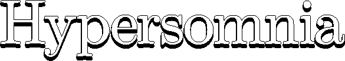

#

### 🇵🇱 **Patryk B. Czachurski [(*Pythagoras*)](https://github.com/geneotech/)**

*Lead developer*
 

### 🇵🇱 **Zbigniew *Spicmir* Vershtrup**

*Graphics design & animations*
 

### 🇵🇱 **Michał [*Billan*](https://www.facebook.com/profile.php?id=100001200683900) Kawczyński**

*Level design*
 

### 🇵🇱 **Ernest [*Hajt*](https://github.com/ernestpasnik) Paśnik**

***[Web](https://hypersomnia.xyz)*** *backend developer*  

## Our team is made up of **volunteers only**.

And I **didn't have to ask** any of them.

They simply loved the project and offered to come and help, for which I am eternally grateful.

External assets used in the game are credited at [hypersomnia.io/credits](https://hypersomnia.io/credits).

#

*Hypersomnia is completely* ***[free and open-source.](https://github.com/TeamHypersomnia/Hypersomnia#intro)***

